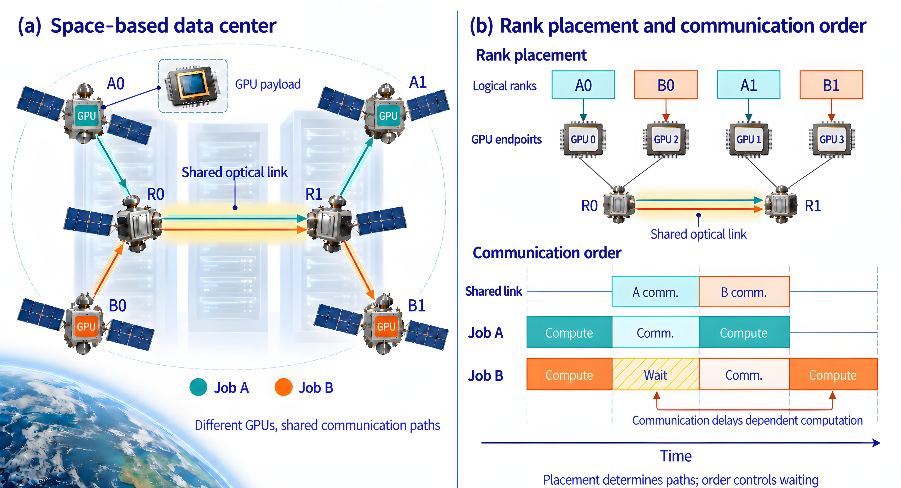
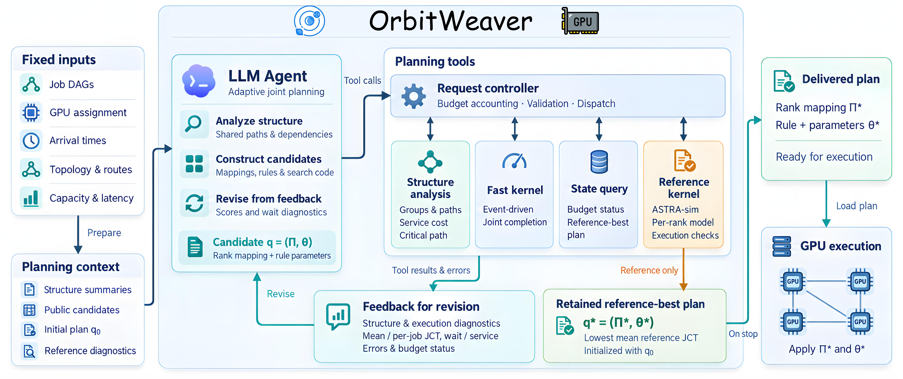
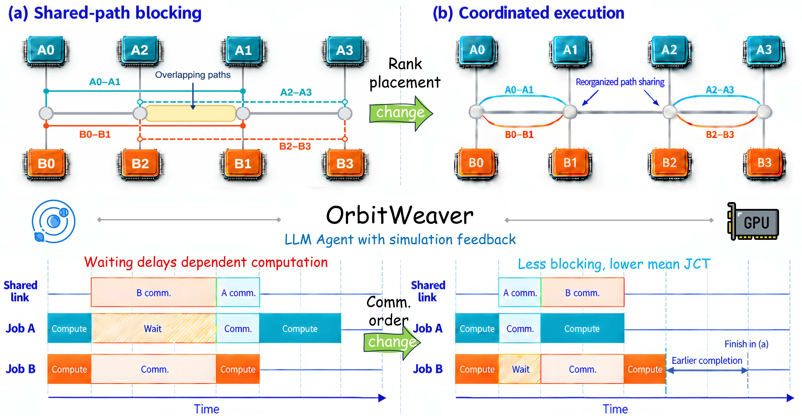
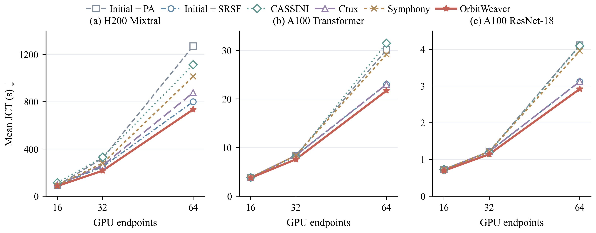

<div align="center">

# OrbitWeaver

**LLM Agent Planning for Optically Interconnected Orbital GPU Clusters**

[](https://www.python.org/)
[](LICENSE)
[](https://github.com/luopeng69131/OrbitWeaver/actions/workflows/tests.yml)

**English · [简体中文](README_zh.md)**

[Overview](#why-orbitweaver) · [Quick start](#quick-start) · [Data preparation](#data-preparation) · [Method](docs/method.md)

</div>

## Why OrbitWeaver?

Space-based data-center designs bring accelerators into close orbital formations connected by optical inter-satellite links. With a finite number of neighboring connections, communications traverse relay paths. Concurrent training jobs can therefore compete for the same links even when they occupy separate GPUs.

**OrbitWeaver coordinates where ranks run and when their communications proceed.** An LLM agent examines communication subgroups, shared paths and execution dependencies, proposes joint plans, and refines them with simulation feedback. The resulting plan connects placement decisions to communication progress and job completion.

<p align="center"></p>

## How it works

<p align="center"></p>

1. **Understand the workload.** Turn measured traces into execution graphs and expose subgroup demand, routed links and dependency progress.
2. **Construct joint candidates.** The agent permutes ranks within their allocations and selects communication priorities.
3. **Explore with feedback.** Fast evaluation guides trials; reference evaluation supplies complete-execution scores and waiting diagnostics.
4. **Deliver a validated plan.** A budget controller retains the best reference-validated result and records request costs.

Explore the [planning loop](src/orbitweaver/planner.py), [structural tools](src/orbitweaver/analysis.py), [agent interface](src/orbitweaver/agent.py) and [trace adapters](src/orbitweaver/data).

<details>
<summary><b>See the effect of joint placement and communication order</b></summary>
<p align="center"></p>
</details>

## Results at a glance

The trace-driven study uses H200 and A100 workloads across 16–64 simulated GPU endpoints. OrbitWeaver reduces aggregate mean job completion time by **6.2–33.5%** relative to CASSINI, Crux and Symphony.

<p align="center"></p>

## Quick start

### Install

```bash
git clone https://github.com/luopeng69131/OrbitWeaver.git
cd OrbitWeaver
python3.11 -m venv .venv
source .venv/bin/activate
pip install -e .
```

### Explore the planning tools

Generate an example workload and exercise structural analysis, fast scoring and reference selection:

```bash
orbitweaver demo --output runs/demo
```

The output contains `problem.json`, `session.json`, `result.json` and `costs.jsonl`. The [Python example](examples/plan_with_tools.py) shows how to call the same tools directly.

### Run an LLM agent

Install and authenticate the [Codex CLI](https://developers.openai.com/codex/cli/), then start a planning session:

```bash
orbitweaver run-agent   --problem runs/demo/problem.json   --output runs/agent   --model gpt-6.1-sol   --effort xhigh
```

The session exposes `analyze`, `probe`, `budget` and `best` through `lab.py`. Default budgets are 64 fast requests and eight reference requests. Initialization, candidate evaluations, failed attempts, cache hits and model usage are recorded in the session outputs.

## Data preparation

| Workload source | Preparation |
|---|---|
| **H200 / NeMo Mixtral** — [MLCommons Chakra MLSys 2026 artifact](https://doi.org/10.5281/zenodo.19636323), Sridharan et al., 2026 | Verify the source archive, link host/device traces with Chakra, and normalize per-rank ET records. |
| **A100 synchronous training** — OrbitWeaver's [CUDA-event capture program](scripts/capture_a100.py) | Measure Transformer or ResNet-18 segments and build a dependency graph from per-rank records. |

```bash
orbitweaver convert-chakra --input data/h200/et --output data/h200_graph.json
orbitweaver build-case --graph data/h200_graph.json   --jobs 4 --condition slow-links --output data/h200_case.json
```

The pipeline preserves compute durations and dependencies, matches collective participants, and replays complete windows to construct concurrent jobs. [Data preparation](docs/data.md) covers source acquisition, checksums, A100 collection, and all processing commands.

## Make it your own

- **Simulation backends:** connect evaluators through the [JSON command contract](docs/backends.md).
- **Planning tools:** use graph, path-demand and waiting diagnostics to construct new candidates.
- **Scenarios:** configure allocations, arrival timing, optical-link capacity and whole-window repetition.

The package includes a critical-path evaluator and a resource-aware event-replay backend. The command adapter connects the same planner to external fast and reference simulators.

## Community and license

Ideas, integrations and extensions are welcome through [Issues](https://github.com/luopeng69131/OrbitWeaver/issues) and pull requests.

Developed by **Pengcheng Luo and Bowen Zhang**. Licensed under [Apache-2.0](LICENSE). Data sources and schema attribution are listed in [THIRD_PARTY_NOTICES.md](THIRD_PARTY_NOTICES.md).
