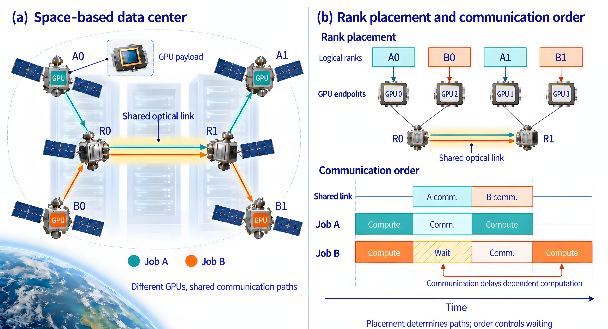
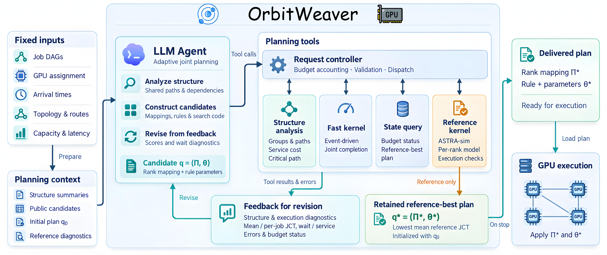
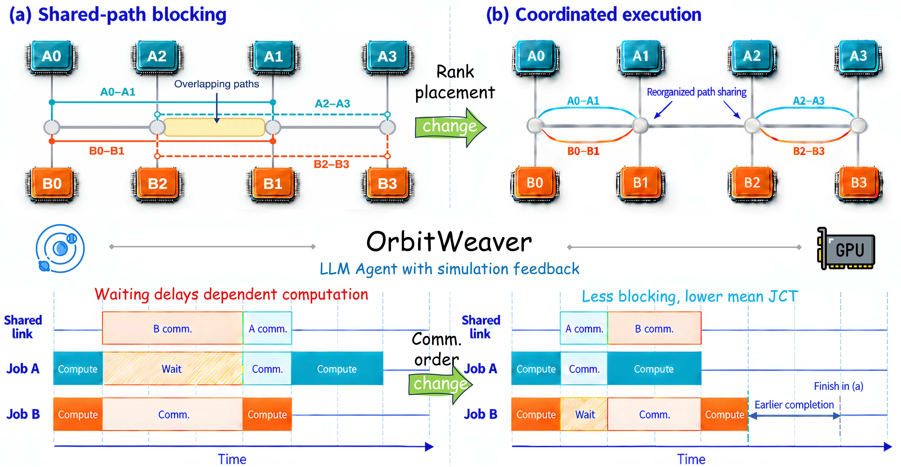
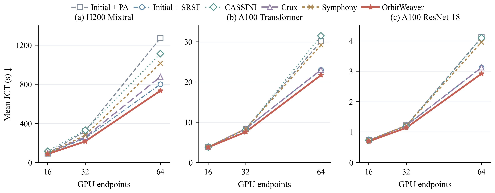

<div align="center">

# OrbitWeaver

**面向光互连在轨 GPU 集群的 LLM Agent 联合规划**

[](https://www.python.org/)
[](LICENSE)
[](https://github.com/luopeng69131/OrbitWeaver/actions/workflows/tests.yml)

**[English](README.md) · 简体中文**

[背景](#为什么需要-orbitweaver) · [快速开始](#快速开始) · [A100 数据](datasets/a100) · [仿真器](docs/simulator.md) · [数据准备](#数据准备) · [方法说明](docs/method.md)

</div>

## 为什么需要 OrbitWeaver？

太空数据中心的一类设计将加速器部署在近距离编队飞行的卫星上，通过星间光链路互连。每颗卫星的邻接连接数量有限，远端通信需要经过中继路径。因此，即使多个训练作业使用不同的 GPU，它们仍可能争用相同的光链路。

**OrbitWeaver 同时规划 rank 放置和通信顺序。** LLM Agent 分析通信子组、共享路径与执行依赖，构造联合方案，并通过仿真反馈持续调整，让放置决策与通信推进相互配合，减少作业执行中的阻塞。

<p align="center"></p>

## 开放资源

- **方法核心**：结构分析、联合方案、Agent 交互与预算控制。
- **自采 A100 数据**：[Transformer 和 ResNet-18](datasets/a100)，每组包含八个 rank 文件、采集元数据与 SHA-256 校验。
- **在轨 GPU 问题仿真器**：C++ 事件内核、光互连模型、可配置场景，以及接入新放置／调度策略的 Python API。

## 方法如何工作？

<p align="center"></p>

1. **理解负载结构。** 将实测 trace 转为执行图，提取子组需求、经过的链路与依赖推进特征。
2. **构造联合候选。** Agent 在作业分配的 GPU 内置换 rank，并选择通信优先级。
3. **利用反馈探索。** 快速评估引导候选探索，参考评估提供完整执行成绩和等待诊断。
4. **交付验证方案。** 预算控制器保留参考评估最优的可行方案，并记录各次请求成本。

核心入口包括[规划循环](src/orbitweaver/planner.py)、[结构分析](src/orbitweaver/analysis.py)、[Agent 接口](src/orbitweaver/agent.py)和[数据处理模块](src/orbitweaver/data)。

<details>
<summary><b>查看联合放置与通信顺序的直观效果</b></summary>
<p align="center"></p>
</details>

## 效果概览

基于 H200、A100 负载的 trace 驱动研究覆盖 16–64 个模拟 GPU 端点。相较 CASSINI、Crux 和 Symphony，OrbitWeaver 将聚合平均作业完成时间降低 **6.2–33.5%**。

<p align="center"></p>

## 快速开始

### 安装

```bash
git clone https://github.com/luopeng69131/OrbitWeaver.git
cd OrbitWeaver
python3.11 -m venv .venv
source .venv/bin/activate
pip install -e .
```

### 使用实测 A100 数据运行仿真器

构建 C++17 内核、处理执行图，并运行一个在轨集群场景：

```bash
orbitweaver build-simulator --output build/native
orbitweaver convert-a100 \
  --input datasets/a100/transformer --output data/transformer_graph.json
orbitweaver build-case --graph data/transformer_graph.json \
  --jobs 4 --condition slow-links --output data/transformer_case.json
orbitweaver simulate --problem data/transformer_case.json \
  --binary-directory build/native --output runs/transformer
```

输出包括平均／逐作业 JCT、执行完成审计和进程成本。
[仿真器说明](docs/simulator.md)介绍如何修改 GPU 分配、到达时间、链路容量和通信优先级。

### 体验规划工具

```bash
orbitweaver demo --output runs/demo
```

这个合成负载示例展示结构分析、快速评分与参考方案选择；
[Python 示例](examples/plan_with_tools.py)给出了相同工具的直接调用方式。

### 运行 LLM Agent

安装并登录 [Codex CLI](https://developers.openai.com/codex/cli/)，然后启动规划会话：

```bash
orbitweaver run-agent \
  --problem data/transformer_case.json \
  --output runs/agent \
  --native-binary-directory build/native \
  --model gpt-6.1-sol --effort xhigh
```

会话通过 `lab.py` 提供 `analyze`、`probe`、`budget` 和 `best`。默认预算为 64 次快速请求和 8 次参考请求。初始化、候选评估、失败尝试、缓存命中以及模型用量均记录在会话输出中。

## 数据准备

| 负载来源 | 处理流程 |
|---|---|
| **H200 / NeMo Mixtral**：[MLCommons Chakra MLSys 2026 artifact](https://doi.org/10.5281/zenodo.19636323)，Sridharan 等，2026 | 校验源压缩包，使用 Chakra 连接 host/device trace，再规范化各 rank 的 ET 记录。 |
| **A100 同步训练**：[已发布实测数据](datasets/a100)与 [CUDA Event 采集程序](scripts/capture_a100.py) | 处理仓库提供的 Transformer／ResNet-18 记录，或采集新的训练负载。 |

```bash
orbitweaver convert-chakra --input data/h200/et --output data/h200_graph.json
orbitweaver build-case --graph data/h200_graph.json   --jobs 4 --condition slow-links --output data/h200_case.json
```

处理流程保留计算时长和执行依赖，匹配集体通信的参与者，并通过完整窗口重放构造并发作业。[数据准备说明](docs/data.md)提供来源获取、校验信息、A100 采集和各阶段命令。

## 扩展 OrbitWeaver

- **仿真后端**：通过 [JSON 命令接口](docs/backends.md)接入评估器。
- **规划工具**：利用执行图、路径需求与等待诊断构造新候选。
- **实验场景**：配置 GPU 分配、到达时刻、光链路容量及完整窗口重复次数。

软件包提供 C++ 原生仿真器、关键路径评估器与便于阅读的 Python 事件重放后端；命令适配器将同一规划器连接到外部快速仿真器和参考仿真器。

## 交流与许可

欢迎通过 [Issues](https://github.com/luopeng69131/OrbitWeaver/issues) 和 Pull Request 交流想法、后端集成和方法扩展。

开发者：**Pengcheng Luo、Bowen Zhang**。项目采用 [Apache-2.0](LICENSE) 许可。数据来源与 schema 归属见 [THIRD_PARTY_NOTICES.md](THIRD_PARTY_NOTICES.md)。
